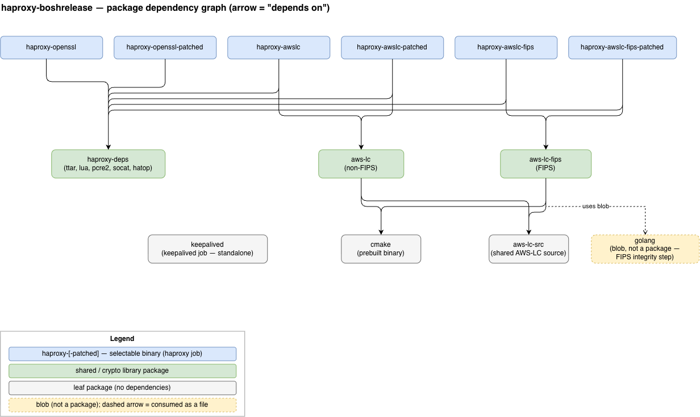

# BOSH Release for HAProxy

Questions? Pop in our [slack channel](https://cloudfoundry.slack.com/messages/haproxy-boshrelease/)!

This BOSH release is an attempt to get a more customizable/secure HAProxy release than what
is provided in [cf-release](https://github.com/cloudfoundry/cf-release). It allows users to
blocklist internal-only domains, preventing potential Host header spoofing from allowing
unauthorized access of internal APIs. It also allows for better control over HAProxy's
timeouts, for greater resiliency under heavy load.

## Usage

To deploy this BOSH release:

```bash
git clone https://github.com/cloudfoundry-community/haproxy-boshrelease.git
cd haproxy-boshrelease

export BOSH_ENVIRONMENT=<alias>
export BOSH_DEPLOYMENT=haproxy
bosh deploy manifests/haproxy.yml \
  -v haproxy-backend-port=80 \
  -v "haproxy-backend-servers=[10.10.10.10,10.10.10.11]"
```

To make alterations to the deployment you can use the `bosh deploy [-o operator-file.yml]` flag to provide [operations files](https://bosh.io/docs/cli-ops-files.html).

## Documentation

- [External Certificates](/docs/external_certs.md) - Using HAProxy with additional external certificates
- [Mutual TLS](/docs/mutual_tls.md) - Mutual TLS configuration
- [Rate Limiting](/docs/rate_limiting.md) - Client IP based rate limiting
- [Keepalived](/docs/keepalived.md) - Keepalived integration for high availability
- [Core Dumps](/docs/coredumps.md) - Enabling core dumps for HAProxy debugging
- [Dependency Updates](/docs/version-bumps.md) - How to bump dependency versions
- [Release Process](/docs/release-process.md) - How to create a new release

## Development

Feel free to contribute back to this via a pull request on a feature branch! Once merged, we'll
cut a new final release for you.

### Unit Tests and Linting

#### PR Validation
PRs will be automatically tested by https://concourse.arp.cloudfoundry.org/teams/main/pipelines/haproxy-boshrelease once a maintainer has labeled the PR with the `run-ci` label

#### Local Test Execution
Unit/RSpec tests and linters can be run locally to verify correct functionality before pushing to the CI system.
If you change any ERB logic in the jobs directory, please add a corresponding test to `spec`.

```bash
# install the necessary dependencies, once
bundle package
```

```bash
# run the rspec / unit tests for the configuration generation
cd haproxy_boshrelease
bundle install
bundle exec rake spec
```

```bash
# run the linter (rubocop) to identify any issues
cd haproxy_boshrelease
bundle install
bundle exec rake lint
```

```bash
# watch the tests while developing
cd haproxy_boshrelease
bundle install
bundle exec guard
```

#### Test Debugging
Unit/RSpec tests can also be debugged/stepped through when needed. See for example the [VSCode rdbg Ruby Debugger](https://marketplace.visualstudio.com/items?itemName=KoichiSasada.vscode-rdbg) extension. You can follow the "Launch without configuration" instructions for the extension, just set the "Debug command line" input to `bundle exec rspec <filepath>`.

### Acceptance Tests

See [acceptance-tests README](/acceptance-tests/README.md).

### Local Dev Builds

`scripts/dev-build.sh` builds the release tarball and uploads it to the targeted BOSH
director. Useful for iterating on packaging changes without going through CI.

```bash
./scripts/dev-build.sh                       # build, version=dev
./scripts/dev-build.sh --version 1.0         # custom version tag
./scripts/dev-build.sh --upload-only         # re-upload previously built tarballs
```

Tarballs are written to `./builds/` and uploaded with `bosh upload-release --fix`.

### Packaging model

`packages/` holds **every** package, and `bosh create-release` bundles all of them, so a plain
`bosh create-release` of the committed tree produces the one release — there is no build-time
assembly. The `haproxy` job lists all six `haproxy-*` binaries; the SSL backend is chosen at deploy
time via `ha_proxy.ssl_variant` (default `openssl`) and `ha_proxy.include_haproxy_patches` 
(default `false`), handled in `jobs/haproxy/templates/haproxy_wrapper.erb`.

Dependencies are one-directional: every `haproxy-*` binary depends on the shared `haproxy-deps`
(lua, pcre2, socat, hatop), compiled once. AWS-LC is compiled from a single shared `aws-lc-src` source
package used by both the non-FIPS `aws-lc` and the FIPS `aws-lc-fips` compile packages (FIPS differs
only by `-DFIPS=1` plus the Go toolchain for the integrity step). Because `aws-lc`/`aws-lc-fips` do not
bundle the HAProxy version file, their fingerprints are independent of HAProxy — a HAProxy bump reuses
the cached AWS-LC compile instead of rebuilding it. The HAProxy community patches (the optional
`-patched` builds) are plain source files under `src/haproxy-patches/`, applied at compile time by
`src/apply-patches.sh`.

### Package dependency diagram



Source: [`docs/package-dependencies.drawio`](docs/package-dependencies.drawio) (editable in [diagrams.net](https://app.diagrams.net/)).